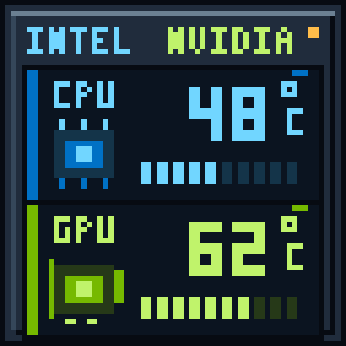

# wmpixeltemp

A 64 × 64 pixel-art dockapp for Window Maker on Linux/X11. It shows CPU and GPU temperatures in degrees Celsius, using Intel-inspired blue (`#0071C5`) and NVIDIA green (`#76B900`). The lettering, icons, and bars are drawn directly in C with Xlib.



## Build and run

You'll need a C compiler, Make, pkg-config, and the Xlib development headers. On Debian or Ubuntu, install `build-essential pkg-config libx11-dev`; on Fedora, install `gcc make pkgconf-pkg-config libX11-devel`.

```sh
make
./wmpixeltemp
```

Drag the application icon into the Window Maker Dock. Right-click the docked icon to open Window Maker's native menu and configure the launcher. Left-click to refresh the readings. In windowed mode, press **R** to refresh or **Q** or **Esc** to quit.

To install for your user: `make install PREFIX="$HOME/.local"`. To remove the binary: `make uninstall PREFIX="$HOME/.local"`.

```sh
./wmpixeltemp --once              # Read sensors without opening a window
./wmpixeltemp --windowed          # Run in a regular X11 window
./wmpixeltemp --demo --scale 4    # Preview with simulated readings
./wmpixeltemp --interval 3        # Sample every three seconds
./wmpixeltemp --gpu-index 1       # Select the second NVML device
./wmpixeltemp --help
```

## Sensor readings

- **CPU:** Displays the highest valid reading from recognized CPU drivers in Linux hwmon (including Intel `coretemp` and AMD `k10temp`). Recognized CPU thermal zones are used as a fallback.
- **GPU:** Tries NVIDIA NVML first, then Linux DRM hwmon. In the fallback, `--gpu-index N` selects `cardN`; DRM and NVIDIA may number devices differently. NVML is loaded at runtime from the installed NVIDIA driver, so the CUDA SDK is not needed.
- **Overrides:** Use `--cpu-file PATH` and `--gpu-file PATH` to read specific sysfs files. Values must be in millidegrees Celsius.
- **Display:** Readings refresh every two seconds by default. A missing reading appears as `--`. Each bar segment represents 10 °C; colors change at 80 °C and 90 °C as visual cues, independent of manufacturer limits.

Run `make test` with Python 3 to check sensor detection, missing readings, CLI options, and image export. Docking and the native right-click menu were also tested in Window Maker under Xvfb.

## AI disclosure and credits

- **[thebuyan](https://github.com/thebuyan):** Project idea, design brief, and feedback on the dock interactions.
- **[OpenAI Codex](https://openai.com/codex/):** AI coding assistant that generated the C implementation, pixel artwork, tests, build files, and documentation, and made revisions based on the user's feedback. This project was created with AI.
- **Technical references:** [Window Maker and its dockapp examples](https://github.com/window-maker/dockapps), [X.Org Xlib](https://www.x.org/releases/current/doc/libX11/libX11/libX11.html), [Linux hwmon](https://docs.kernel.org/hwmon/sysfs-interface.html), and [NVIDIA NVML](https://docs.nvidia.com/deploy/nvml-api/). Runtime technologies and documentation are credited to their respective projects.

Intel and NVIDIA names and colors are used as visual references. This project is independent and is not affiliated with or endorsed by either company.

Licensed under the [MIT License](LICENSE).
